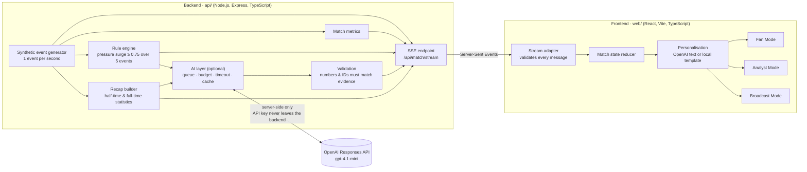

# MatchMind AI

**Live football match intelligence that explains *why* a moment matters, for fans, analysts and broadcasters, in four languages.**

MatchMind AI turns a live stream of match events into evidence-backed insights, explains them with OpenAI's `gpt-4.1-mini` for three different audiences, and writes half-time and full-time recaps. Every number shown is traceable to the events that produced it, and the app keeps working without AI using local templates.

> Built for the Microsoft × Premier League hackathon. The match data is **synthetic** (simulated), not real Premier League data. This project is not affiliated with or endorsed by the Premier League, Microsoft or any club.

---

## Contents

- [The problem](#the-problem)
- [How it works: the five-stage pipeline](#how-it-works-the-five-stage-pipeline)
- [Architecture](#architecture)
- [Three modes](#three-modes)
- [Features](#features)
- [Technology stack](#technology-stack)
- [Getting started](#getting-started)
- [Configuration](#configuration)
- [Running without OpenAI](#running-without-openai)
- [Tests and verification](#tests-and-verification)
- [API reference](#api-reference)
- [Limitations](#limitations)
- [Responsible use](#responsible-use)
- [Hackathon submission overview](#hackathon-submission-overview)

---

## The problem

Live football data is plentiful, but it rarely explains itself. A fan sees a score and a few numbers, an analyst gets raw event logs, and a broadcaster needs short, accurate copy within seconds. Turning the same data into a clear explanation for each of these audiences is slow, and AI-generated commentary can easily state things the data does not support.

MatchMind AI addresses this by:

- detecting significant patterns with transparent, rule-based logic;
- tying every insight to the specific events that triggered it;
- adapting the explanation to the audience and language, with AI wording that is validated against the evidence before it is shown;
- always falling back to deterministic local text when AI is unavailable.

---

## How it works: the five-stage pipeline

| Stage | What happens | Where |
| --- | --- | --- |
| **1. Ingest** | A synthetic match generator produces one event per second (passes, shots, tackles, pressure) and streams it to clients over Server-Sent Events (SSE). | `api/src/index.ts`, `api/src/data.ts` |
| **2. Interpret** | A rule engine detects sustained pressure: a team's last 5 pressure events averaging at least 0.75 intensity. Each insight carries its evidence event IDs and a confidence value set by the rule. Match-wide passing metrics are also computed. | `api/src/rules.ts`, `api/src/metrics.ts` |
| **3. Explain** | Selected insights are sent, as a compact evidence payload, to the OpenAI Responses API (`gpt-4.1-mini`), which writes fan, analyst and broadcast versions in four languages. The backend validates every version before publishing it. | `api/src/ai/` |
| **4. Render** | The React frontend shows the match in Fan, Analyst or Broadcast mode, with scoreboards, charts, timelines and on-air graphics. | `web/src/components/` |
| **5. Personalise** | Text is shown for the selected audience and language: validated OpenAI wording when available, otherwise local templates, with a badge stating which. | `web/src/lib/personalisation.ts`, `web/src/lib/explanation.tsx` |

---

## Architecture



Key design points:

- **AI never blocks the match.** The event loop broadcasts each event first; OpenAI work runs asynchronously, and its results arrive later as separate SSE messages.
- **The original event payload is unchanged.** AI output uses its own message types, so clients that ignore them keep working.
- **The model never owns the facts.** Evidence event IDs, confidence values and all recap statistics are computed by the backend. The model only writes wording, and any wording that quotes a number not found in the evidence is discarded.

---

## Three modes

### Fan Mode

A match-centre view for supporters: a prominent scoreboard with match status (Live, Half-time, Full-time), match momentum, key stats, a live event timeline, AI Insights explained in accessible language, team comparison, and the half-time/full-time recap. Tabs: Overview, Live Events, AI Insights and Team Stats.

### Analyst Mode

A tactical view with period filters (full match, first half, second half or a custom minute range) and five tabs: Tactical Overview, Player Analysis, Passing Network, Team Comparison and Event Analysis. Tactical insights show the explanation, an evidence note, the backend's original wording and links to the evidence events. Unavailable data is labelled as such rather than estimated.

### Broadcast Mode

A production-studio interface for on-screen graphics: Program and Preview monitors with a **Take** control, a scene library, a graphics library, overlay controls (scoreboard, insight banner, player lower third, tactical overlays, stats ticker, branding), operator notices for half-time, full-time and feed interruptions, and an optional local video file as the background. Output is a **local preview only**: there is no streaming, RTMP or recording.

---

## Features

### Synthetic football event generation

The backend simulates a match between Manchester United and Arsenal, with synthetic squads (player IDs such as `mun_7`, not real players). One event is generated per second of match time:

- mostly passes (with completion, pressure and recipient), tackles (won or lost) and rare shots (goal, on target, saved, blocked or off target);
- recurring periods of high pressure for each team, so the pressure rule can be demonstrated;
- the score changes only when a shot event's outcome is a goal;
- a match lifecycle: half-time at 45:00, a break, then the second half to full time at 90:00.

### Evidence-backed pressure insights

`api/src/rules.ts` emits a `pressure_surge` insight when a team's last 5 pressure events average at least **0.75** intensity (0–1 scale). It fires once per surge and can fire again after the pressure drops. Each insight includes:

- `evidence_event_ids`: the 5 events that triggered it;
- `confidence`: set by the rule (0.9);
- an explanation that states what the data does *not* prove (pressure intensity is not territorial control or chance quality).

The frontend can recompute the average from the evidence events it received, and Analyst Mode links each insight to those events.

### OpenAI-generated explanations (gpt-4.1-mini)

When enabled, the backend sends selected insights to the **OpenAI API** (the Responses API at `api.openai.com`, with structured JSON output). One request returns **12 versions**: Fan, Analyst and Broadcast in English, Spanish, French and Yoruba.

- **Fan:** clear, engaging storytelling.
- **Analyst:** precise interpretation that cites the evidence and states uncertainty.
- **Broadcast:** short, punchy copy for on-screen overlays.

The model receives only verified data: team names, score, match clock and minute, insight type, pressure values and average, evidence count and match-wide passing totals. No player names are sent.

**Validation before display.** Each version is checked independently and rejected if it:

- quotes a number that does not appear in the evidence (at the precision used);
- mentions an event or player ID that was not supplied;
- names a stadium or venue (none is in the data);
- writes a count as a Yoruba number word that cannot be verified;
- is empty or over its length limit.

A rejected version is dropped, and that language/audience falls back to its local template.

**Cost and safety controls** (all configurable): a per-match call budget (default 10 calls: up to 8 explanations and 2 recaps), one request at a time with a minimum interval, a bounded queue, per-request timeouts, output-token caps, a response cache, and an automatic stop for the rest of the run after a rejected key or unknown model. Not every insight is sent: by default a team's next insight is sent only 10 match minutes after its previous one.

> **OpenAI API, not Azure OpenAI.** This project calls the OpenAI API directly with an OpenAI API key. It does not use Azure OpenAI Service or any other Azure service.

### Automated half-time and full-time recaps

At half-time and full-time the backend builds a recap from the **actual accumulated events**: score, passes and pass accuracy, shots and shots on target, goals, tackles won, pressure events and average intensity, pressure surges per team, and the strongest pressure moments. The full-time recap also includes each half separately.

1. The statistical recap is published immediately.
2. If OpenAI is enabled, a recap in 3 audiences × 4 languages is requested and validated against those statistics.
3. Each phase's recap is generated at most once, stored in memory, and replayed to clients that connect or reconnect later.

If OpenAI is off, slow or fails, the frontend shows a deterministic **local summary** built from the same statistics, in the selected language. The recap panel appears in Fan Mode (Overview and AI Insights tabs), Analyst Mode (Tactical Overview) and Broadcast Mode (side panel).

### Personalisation in English, Spanish, French and Yoruba

The language selector in the sidebar switches all insight text, recaps and badges between **English, Español, Français and Yorùbá**. Each insight and recap carries a badge stating where its wording came from:

- **OpenAI · gpt-4.1-mini · ES**: generated on the backend and validated;
- **Local template · ES** (or **Local summary** for recaps): built-in template, no language model involved;
- **Backend text · untranslated**: the backend's original wording, used when no template exists.

---

## Technology stack

| Layer | Technologies |
| --- | --- |
| Backend | Node.js, TypeScript, Express 5, `cors`, `dotenv`, `tsx` (dev runner), Node's built-in test runner |
| AI | OpenAI Responses API via `fetch` (no SDK), model `gpt-4.1-mini` by default, strict JSON-schema output |
| Real-time | Server-Sent Events (SSE) |
| Frontend | React 19, TypeScript, Vite 8, plain CSS with design tokens (no UI framework), ESLint |
| Frontend tests | Node scripts that load the real TypeScript modules through Vite's SSR loader |

There is no database: match state, insights, narratives and recaps live in backend memory for the current run.

---

## Getting started

### Prerequisites

- **Node.js 20.19+ or 22.12+** (required by Vite 8) and npm
- Optional: an **OpenAI API key** with access to `gpt-4.1-mini`

### Installation

The backend and frontend are separate npm packages; there is no root `package.json`. Run each command block below from the repository root.

```bash
git clone https://github.com/Ikenna-007/matchmind-ai.git
cd matchmind-ai
git checkout feature/frontend
```

```bash
cd api && npm install
```

```bash
cd web && npm install
```

### Run the backend (terminal 1)

```bash
cd api
npm run dev
```

The API listens on **http://localhost:4000**. `npm run dev` runs `tsx watch src/index.ts`, so the server restarts (and starts a new match) when backend source files change.

### Run the frontend (terminal 2)

```bash
cd web
npm run dev
```

Open the URL Vite prints (by default **http://localhost:5173**). The frontend connects to `http://localhost:4000/api/match/stream`; to use a different backend, set `VITE_MATCH_STREAM_URL` (for example in `web/.env.local`).

### Faster demo matches

A full match takes 90 minutes at the default one event per second. To reach half-time and full-time faster, override the timings when starting the backend (macOS/Linux shells):

```bash
cd api
EVENT_INTERVAL_MS=40 HALF_TIME_BREAK_MS=8000 npm run dev
```

At 40 ms per event a match lasts about 4 minutes. The same variables can be set in `api/.env` instead.

### Production build of the frontend

```bash
cd web
npm run build
npm run preview
```

---

## Configuration

Backend settings are read from `api/.env`, which is git-ignored (`.gitignore` ignores `.env` and `.env.*`, except `.env.example`). Start from the template:

```bash
cd api
cp .env.example .env
```

(On Windows: `copy .env.example .env`.)

Then edit `api/.env`:

```dotenv
OPENAI_ENABLED=true
OPENAI_API_KEY=your-openai-api-key
OPENAI_MODEL=gpt-4.1-mini
```

| Variable | Default | Purpose |
| --- | --- | --- |
| `OPENAI_ENABLED` | off | AI runs only when this is `true` **and** a key is set |
| `OPENAI_API_KEY` | none | OpenAI API key (backend only) |
| `OPENAI_MODEL` | `gpt-4.1-mini` | Model used for explanations and recaps |
| `OPENAI_MAX_CALLS_PER_MATCH` | `10` | Hard cap on OpenAI calls per match |
| `OPENAI_MAX_INSIGHT_CALLS` | `8` | Explanation calls per match (capped at the total minus 2, which stay reserved for recaps) |
| `OPENAI_TEAM_GAP_SECONDS` | `600` | Match seconds between explanations for the same team |
| `OPENAI_TIMEOUT_MS` | `30000` | Timeout per explanation request |
| `OPENAI_RECAP_TIMEOUT_MS` | `60000` | Timeout per recap request |
| `OPENAI_MAX_OUTPUT_TOKENS` | `2000` | Output-token cap per explanation request |
| `OPENAI_RECAP_MAX_OUTPUT_TOKENS` | `3500` | Output-token cap per recap request |
| `OPENAI_MIN_INTERVAL_MS` | `2000` | Minimum spacing between OpenAI calls |
| `OPENAI_QUEUE_SIZE` | `3` | Explanation requests allowed to wait |
| `EVENT_INTERVAL_MS` | `1000` | Real milliseconds per generated event |
| `HALF_TIME_BREAK_MS` | `15000` | Length of the half-time break |

**Keeping the key safe**

- Put the key only in `api/.env`, never in `.env.example`, frontend files or commits.
- The key is used only by the backend's request to OpenAI. It is not sent to the browser, included in SSE messages or returned by `/api/ai/status`, and error messages are redacted before logging.
- The frontend has no OpenAI configuration, and must never be given one: any `VITE_` variable is bundled into public JavaScript.
- If a key is ever committed or shared, revoke it in the OpenAI dashboard and create a new one.

---

## Running without OpenAI

OpenAI is optional. With `OPENAI_ENABLED` unset or `false`, or no key, the backend logs:

```
[ai] OpenAI disabled (OPENAI_ENABLED is not set to true); using rule-based text and local templates
```

Everything else works as normal: the match simulation, pressure insights, all three modes, all four languages (via local templates), half-time/full-time handling, reconnection, and recaps (as local summaries built from the backend's statistics). Badges show **Local template** or **Local summary**.

If OpenAI is enabled but a request fails, times out or produces text that fails validation, the affected text falls back to the same templates without interrupting the match.

---

## Tests and verification

All tests use mocked or fixture data and make **no OpenAI calls**.

**Backend** (`api/`):

```bash
cd api
npm test
npm run typecheck
```

`npm test` covers configuration, the OpenAI client (request format, error redaction, timeouts, incomplete responses), the scheduler (budget, queue, cache, fatal-error stop), evidence validation, insight selection and recap generation.

**Frontend** (`web/`):

```bash
cd web
npm run lint
npm run build
npm test
```

`npm test` runs both suites, which can also be run separately:

```bash
cd web
npm run test:explanations
npm run test:ai
```

- `test:explanations` checks template personalisation for every insight type, audience and language, and payload compatibility.
- `test:ai` checks the AI stream messages through the adapter, reducer, personalisation and local recap fallback.

**Visual check of insight wording:** with `npm run dev` running in `web/`, open `http://localhost:5173/?insight-fixtures` for a development-only page that renders fixture insights in all three modes (it is excluded from production builds).

**Checking AI status at runtime:**

```bash
curl http://localhost:4000/api/ai/status
```

---

## API reference

Base URL: `http://localhost:4000`

### REST endpoints

| Method & path | Returns |
| --- | --- |
| `GET /api/health` | `{ status: "ok", service: "MatchMind API" }` |
| `GET /api/match` | Current match state: teams, score, clock, status (`live`, `half_time`, `full_time`) |
| `GET /api/teams` | The two teams |
| `GET /api/players` | Synthetic squads |
| `GET /api/match/events` | The latest 100 events |
| `GET /api/match/recaps` | Stored half-time / full-time recaps |
| `GET /api/ai/status` | Whether AI is enabled, the model, budget, call counts, and any reason AI is off (never the key) |
| `GET /api/match/stream` | Server-Sent Events stream (below) |

### SSE message types (`/api/match/stream`)

Each message is a JSON object in an SSE `data:` line.

| Message | When | Shape |
| --- | --- | --- |
| Connected | Once per connection | `{ type: "connected", match }` |
| Match event | Every generated event | `{ event, match, metrics, insights }` |
| Match status | Every 2 s during half-time and after full-time | `{ type: "match_status", match }` |
| Insight narrative | When OpenAI wording for an insight is ready | `{ type: "insight_narrative", match_id, insight_id, narrative: { source: "openai", model, generated_at, latency_ms, variants } }` |
| Match recap | At half-time and full-time, and again when AI text is added | `{ type: "match_recap", recap }` |

- `variants` is keyed by language (`en`, `es`, `fr`, `yo`) and audience (`fan`, `analyst`, `broadcast`). It contains only versions that passed validation.
- A recap's `ai_status` is `pending` (AI text requested), `ready` (AI text included) or `unavailable` (statistics only).
- After `connected`, the server replays stored narratives and recaps so reconnecting clients catch up.
- The match event payload `{ event, match, metrics, insights }` is the original contract and is unchanged by the AI features.

---

## Limitations

- **Synthetic data only.** Events, squads and outcomes are simulated; nothing reflects a real match. There is no possession, xG or pitch-zone analysis.
- **One insight type from the live backend.** The rule engine emits `pressure_surge` only. The frontend has templates for `passing_pattern` and `shot_activity`, but the backend does not generate them.
- **AI coverage is budgeted.** With the default budget, the 8 explanation calls are used in roughly the first 30–35 match minutes; later insights keep their template text. The two recap calls are reserved separately.
- **Validation is numeric and lexical.** It catches numbers, identifiers and venue names that are not in the evidence, but not every overstatement in wording (for example, calling close statistics "balanced").
- **Yoruba.** AI-generated Yoruba is checked like the other languages, and versions that write counts as words are rejected and fall back to the local Yoruba template. Yoruba wording (AI and local templates) should be reviewed by a native speaker.
- **In-memory state.** Restarting the backend starts a new match and clears stored narratives and recaps. A client that connects after an insight was sent receives the narrative but not the earlier insight.
- **Single match, single process.** There is no persistence, authentication or multi-match support.
- **Broadcast output is a local preview**, not a video stream.

---

## Responsible use

- **Synthetic data.** All match events and statistics are generated by the simulator. The UI labels the data as a synthetic simulation, and the AI is instructed not to invent players, goals, events or statistics.
- **Real players.** Player profile cards show real players with information from Wikidata and photos from Wikimedia Commons (CC BY-SA 4.0), credited in the app. They are for presentation only: no live statistic is attributed to a real player.
- **Clubs and branding.** Club names are used for identification only. The app does not use official Premier League or club logos or crests; teams are shown with neutral monogram shields in club colours. The visual style is inspired by the Premier League, but MatchMind AI is its own brand and makes no claim of affiliation or endorsement.
- **AI transparency.** Every AI-written text is labelled with its source and model. Template text is labelled as such. AI wording never replaces the evidence, confidence values or statistics, which come from the backend.

---

## Hackathon submission overview

| | |
| --- | --- |
| **Project** | MatchMind AI: evidence-backed, multilingual match intelligence |
| **Event** | Microsoft × Premier League hackathon |
| **Branch** | `feature/frontend` |
| **What it shows** | A full pipeline from live (synthetic) events to rule-based insights, OpenAI explanations validated against evidence, and audience-specific presentation for fans, analysts and broadcasters, in four languages |
| **AI** | OpenAI API, `gpt-4.1-mini`, Responses API with structured output; optional, with deterministic fallbacks |
| **Run it** | `cd api && npm run dev`, then `cd web && npm run dev`, then open http://localhost:5173 |
| **Not included** | Real match data, Azure services, video streaming, persistence |

**Suggested demo flow**

1. Start the backend with `EVENT_INTERVAL_MS=40 HALF_TIME_BREAK_MS=8000` for a match of about 4 minutes.
2. In Fan Mode, watch insights arrive with *Local template* badges; the selected ones switch to *OpenAI · gpt-4.1-mini* when their narratives arrive.
3. Switch the language to Español, Français or Yorùbá.
4. Compare the same insight in Analyst Mode (evidence, uncertainty) and Broadcast Mode (short on-air copy).
5. Show the half-time and full-time recaps, built from the actual match statistics.
